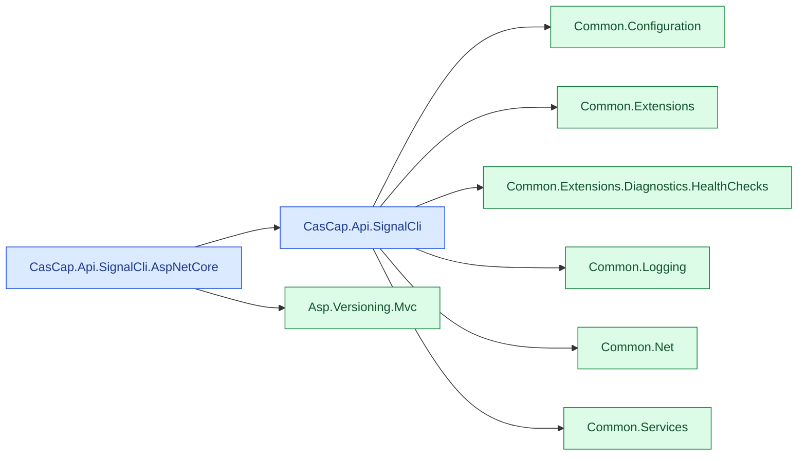

# CasCap.Api.SignalCli

Typed .NET 11 clients for sending and receiving Signal messages through the
[signal-cli REST API](https://github.com/bbernhard/signal-cli-rest-api). Choose HTTP polling or a
persistent JSON-RPC WebSocket receive stream, with optional ASP.NET Core query endpoints.

[CasCap.Api.SignalCli-badge]: https://img.shields.io/nuget/v/CasCap.Api.SignalCli?color=blue
[CasCap.Api.SignalCli-url]: https://nuget.org/packages/CasCap.Api.SignalCli

[](https://github.com/f2calv/CasCap.Api.SignalCli/actions/workflows/ci.yml)
[](https://sonarcloud.io/dashboard?id=f2calv_CasCap.Api.SignalCli)

## Packages

| Package | Purpose | NuGet |
| --- | --- | --- |
| [CasCap.Api.SignalCli](src/CasCap.Api.SignalCli/README.md) | REST client, receive transports, health check and DI registration | [![NuGet version][CasCap.Api.SignalCli-badge]][CasCap.Api.SignalCli-url] |
| [CasCap.Api.SignalCli.AspNetCore](src/CasCap.Api.SignalCli.AspNetCore/README.md) | Authenticated, versioned MVC query controller | [](https://www.nuget.org/packages/CasCap.Api.SignalCli.AspNetCore) |

## Dependency Graph

The optional controller package depends on the core client, not the reverse. Arrows show direct
package references; Microsoft framework dependencies and test-only packages are omitted.



Blue nodes are packages in this repository; green nodes are external packages. Shared-library labels
omit the `CasCap.` prefix. See the [transport flow](src/CasCap.Api.SignalCli/README.md#components)
for HTTP polling versus WebSocket reception.

## Quick Start

```powershell
dotnet package add CasCap.Api.SignalCli
```

Use a .NET 11 Generic Host application and a reachable signal-cli REST API with a registered or linked
account. Configure `CasCap:SignalCliConfig` in the host's configuration:

```json
{
  "CasCap": {
    "SignalCliConfig": {
      "TransportMode": "JsonRpc",
      "BaseAddress": "http://localhost:8080",
      "PhoneNumber": "+10000000000"
    }
  }
}
```

The number is a placeholder; supply your registered account through .NET User Secrets, environment
variables or another secret-backed provider. `TransportMode` must match the server's `MODE`.

```csharp
using CasCap.Abstractions;
using CasCap.Extensions;
using Microsoft.Extensions.DependencyInjection;
using Microsoft.Extensions.Hosting;

var builder = Host.CreateApplicationBuilder(args);
builder.Services.AddSignalCli(builder.Configuration);

using var host = builder.Build();
var client = host.Services.GetRequiredService<ISignalCliClient>();
var about = await client.GetAbout();
Console.WriteLine(about is null ? "API unavailable" : "API reachable");
```

Registration alone does not start message reception. Enumerate
[`ISignalCliReceiver.StreamMessagesAsync`](src/CasCap.Api.SignalCli/Abstractions/ISignalCliReceiver.cs)
from a hosted worker; the [core package README](src/CasCap.Api.SignalCli/README.md) explains the receive
contract, configuration and failure handling.

The core package also emits an OpenTelemetry-compatible `CasCap.Api.SignalCli` meter and activity
source. Exporter configuration remains the consuming host's responsibility.

## Local Sample

The [Generic Host SampleApp](samples/CasCap.Api.SignalCli.GenericHost.SampleApp/README.md) runs against the local signal-cli REST API in
[`docker-compose.yml`](docker-compose.yml). It verifies the API and consumes one long-lived receive stream without logging
sender identities or message content. Attachment metadata and downloaded byte counts are reported without logging
filenames or attachment content.

## Development

With the pinned .NET 11 RC3 SDK, build against published dependencies and run the credential-free subset from
the repository root:

```powershell
dotnet build .\CasCap.Api.SignalCli.Release.slnx --configuration Release
dotnet test --project .\src\CasCap.Api.SignalCli.Tests\CasCap.Api.SignalCli.Tests.csproj --configuration Release --filter-not-trait Category=Integration
```

Debug builds instead use an adjacent [CasCap.Common checkout](https://github.com/f2calv/CasCap.Common).
Restore with the intended configuration; Debug assets do not validate the Release package graph.

Integration tests require a dedicated registered account and can send messages or change remote
state. See the [test README](src/CasCap.Api.SignalCli.Tests/README.md) for prerequisites, exclusions and
the source-declared inventory.

## Documentation

- [REST Client request collections](requests/README.md)
- [Signal](https://signal.org/)

## License

Released under the [MIT License](LICENSE).
