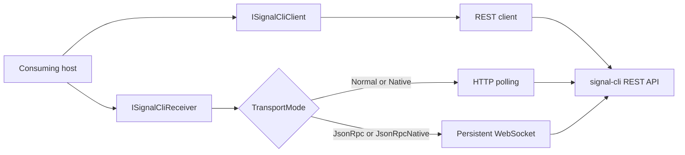

# CasCap.Api.SignalCli

A .NET 10 client for sending, receiving and managing [Signal](https://signal.org) messages through the
[signal-cli REST API](https://bbernhard.github.io/signal-cli-rest-api/). It provides typed REST operations,
HTTP or WebSocket reception, health checks and dependency-injection registration.

## Installation

```bash
dotnet package add CasCap.Api.SignalCli
```

## Usage

In a Generic Host application, register the client against the host's configuration:

```csharp
using CasCap.Abstractions;
using CasCap.Extensions;
using Microsoft.Extensions.DependencyInjection;
using Microsoft.Extensions.Hosting;

var builder = Host.CreateApplicationBuilder(args);
builder.Services.AddSignalCli(builder.Configuration);

using var host = builder.Build();
var client = host.Services.GetRequiredService<ISignalCliClient>();
var about = await client.GetAbout();
Console.WriteLine(about is null ? "API unavailable" : "API reachable");
```

Supply `BaseAddress` and the registered account's `PhoneNumber` as shown in
[Configuration Examples](#configuration-examples). The consuming application supplies logging,
configuration providers and any telemetry exporters.

## Transport Modes

`TransportMode` has four values, mirroring the `MODE` environment variable of the signal-cli REST API server, and **must match whatever the server is running**. Client-side there are only two behaviours: `Normal` and `Native` poll over HTTP, while `JsonRpc` and `JsonRpcNative` receive pushed frames over a WebSocket. The performance and memory characteristics below are properties of the server mode, not of this client.

| Mode | Server `MODE` | Service | Message reception | Server characteristics |
| --- | --- | --- | --- | --- |
| `Normal` | `normal` | `SignalCliRestClientService` | HTTP polling (`GET /v1/receive/{number}`) | JVM process per request |
| `Native` | `native` | `SignalCliRestClientService` | HTTP polling (`GET /v1/receive/{number}`) | Native process per request |
| `JsonRpc` | `json-rpc` | `SignalCliJsonRpcClientService` | WebSocket push (`ws://host/v1/receive/{number}`) | Persistent JVM daemon |
| `JsonRpcNative` | `json-rpc-native` | `SignalCliJsonRpcClientService` | WebSocket push (`ws://host/v1/receive/{number}`) | Persistent native daemon |

On the WebSocket transports the connection is persistent and reconnects automatically with exponential backoff (2 s → 2 min, up to 10 attempts); every non-receive operation still goes over HTTP via the underlying `SignalCliRestClientService`. Registration, verification and device-linking endpoints are unavailable while the server runs in either JSON-RPC mode, per upstream documentation.

## Receiving Messages

Both transports implement
[`ISignalCliReceiver`](https://github.com/f2calv/CasCap.Api.SignalCli/blob/main/src/CasCap.Api.SignalCli/Abstractions/ISignalCliReceiver.cs),
so inbound messages are consumed the same way regardless of `TransportMode`. Switching between HTTP
polling and the WebSocket push stream is a configuration change, not a code change.

```csharp
using CasCap.Abstractions;
using Microsoft.Extensions.Hosting;
using Microsoft.Extensions.Logging;

public sealed class ReceiveWorker(
    ISignalCliReceiver receiver,
    ILogger<ReceiveWorker> logger) : BackgroundService
{
    protected override async Task ExecuteAsync(CancellationToken stoppingToken)
    {
        await foreach (var message in receiver.StreamMessagesAsync(stoppingToken))
        {
            logger.LogInformation("Received envelope with data message: {HasDataMessage}",
                message.Envelope.DataMessage is not null);
        }
    }
}
```

Register the worker with `builder.Services.AddHostedService<ReceiveWorker>()` before building the host,
then run it with `await host.RunAsync()`. This example consumes messages without sending a reply or
logging their contents or sender identities.

`StreamMessagesAsync` is a cold stream: enumeration starts the transport (connecting the WebSocket where applicable) and abandoning the enumerator stops it. Cancelling the token ends the stream by throwing `OperationCanceledException`, per the usual `IAsyncEnumerable` convention. Only one active enumeration per instance is expected; concurrent consumers compete for messages rather than each receiving a copy.

Calling `ConnectAsync` first is optional but surfaces connection failures at startup instead of on the first message. On the REST transport it is a no-op.

## Observability

The library emits provider-neutral diagnostics and does not choose or configure an exporter. A
consuming host registers the stable `CasCap.Api.SignalCli` meter and activity source alongside its
configurable application meter. The library source name is deliberately fixed so dashboards and
instrumentation registration do not vary between hosts. Count-like instruments use the UCUM unit
`1`.

| Metric | Unit | Meaning |
| --- | --- | --- |
| `signalcli.receive.buffered_messages` | `1` | Current messages buffered for consumers |
| `signalcli.receive.connection_attempts` | `1` | Initial and reconnect attempts by bounded outcome |
| `signalcli.receive.frames` | `1` | Received frames by decode outcome |
| `signalcli.receive.reconnections` | `1` | Reconnection attempts |
| `signalcli.receive.stale_streams` | `1` | Streams aborted by the staleness watchdog |

The only dimensions are bounded phase/outcome values. Account numbers, endpoints, sender identities,
and message content are never emitted as metric labels or trace attributes.

`SendMessage` diagnostics report acknowledgement or failure category without message text,
recipient identifiers, response bodies or exception details. Hosts should also avoid HTTP body
logging. A failed or cancelled send does not prove that the recipient received nothing; do not
automatically repeat a send whose outcome is uncertain.

## Controller

The MVC controller lives in a separate
[CasCap.Api.SignalCli.AspNetCore package](https://github.com/f2calv/CasCap.Api.SignalCli/blob/main/src/CasCap.Api.SignalCli.AspNetCore/README.md).
Worker services and console applications need not depend on MVC or API versioning.

## API

Depend on [`ISignalCliClient`](https://github.com/f2calv/CasCap.Api.SignalCli/blob/main/src/CasCap.Api.SignalCli/Abstractions/ISignalCliClient.cs)
rather than the concrete `SignalCliRestClientService` so the client can be
substituted in tests. It resolves to `SignalCliRestClientService` in every transport mode; only message
reception differs. The tables below summarize common operations; the interface provides the complete
signatures, including poll and account-settings operations.

Every method returns `null` or `false` on failure and logs the cause; failures are not thrown. The exception is caller-requested cancellation, which propagates as `OperationCanceledException` so an abandoned call is never mistaken for an API error.

`SignalCliRestClientService` is the `HttpClient`-backed implementation:

### General

| Method | Endpoint | Description |
| --- | --- | --- |
| `GetAbout()` | `GET /v1/about` | Returns version and build information |
| `GetConfiguration()` | `GET /v1/configuration` | Retrieves the signal-cli configuration |
| `SetConfiguration(config)` | `POST /v1/configuration` | Updates the signal-cli configuration |

### Messaging

| Method | Endpoint | Description |
| --- | --- | --- |
| `SendMessage(SignalMessageRequest)` | `POST /v2/send` | Sends a message to one or more recipients |
| `ReceiveMessages(number)` | `GET /v1/receive/{number}` | Receives pending messages for the specified account |
| `ShowTypingIndicator(number, recipient)` | `PUT /v1/typing-indicator/{number}` | Shows a typing indicator |
| `HideTypingIndicator(number, recipient)` | `DELETE /v1/typing-indicator/{number}` | Hides a typing indicator |
| `SendReaction(number, recipient, reaction, targetAuthor, timestamp)` | `POST /v1/reactions/{number}` | Sends a reaction to a message |
| `RemoveReaction(number, recipient, reaction, targetAuthor, timestamp)` | `DELETE /v1/reactions/{number}` | Removes a reaction from a message |
| `SendReceipt(number, recipient, receiptType, timestamp)` | `POST /v1/receipts/{number}` | Sends a read/viewed receipt |
| `RemoteDelete(number, recipient, timestamp)` | `DELETE /v1/remote-delete/{number}` | Remotely deletes a sent message |

### Registration

| Method | Endpoint | Description |
| --- | --- | --- |
| `RegisterNumber(number)` | `POST /v1/register/{number}` | Registers a phone number |
| `VerifyNumber(number, token)` | `POST /v1/register/{number}/verify/{token}` | Verifies registration |
| `UnregisterNumber(number)` | `POST /v1/unregister/{number}` | Unregisters a phone number |

### Accounts

| Method | Endpoint | Description |
| --- | --- | --- |
| `ListAccounts()` | `GET /v1/accounts` | Lists all registered accounts |
| `SetPin(number, pin)` | `POST /v1/accounts/{number}/pin` | Sets a registration PIN |
| `RemovePin(number)` | `DELETE /v1/accounts/{number}/pin` | Removes the registration PIN |
| `SubmitRateLimitChallenge(number, challengeToken, captcha)` | `POST /v1/accounts/{number}/rate-limit-challenge` | Submits a rate-limit challenge |
| `UpdateAccountSettings(number, discoverableByNumber, shareNumber)` | `PUT /v1/accounts/{number}/settings` | Updates account settings |
| `SetUsername(number, username)` | `POST /v1/accounts/{number}/username` | Sets a username |
| `RemoveUsername(number)` | `DELETE /v1/accounts/{number}/username` | Removes the username |

### Contacts

| Method | Endpoint | Description |
| --- | --- | --- |
| `ListContacts(number)` | `GET /v1/contacts/{number}` | Lists contacts for an account |
| `UpdateContact(number, recipient, name, expirationInSeconds)` | `PUT /v1/contacts/{number}` | Updates a contact |
| `SyncContacts(number)` | `POST /v1/contacts/{number}/sync` | Triggers a contact sync |

### Devices

| Method | Endpoint | Description |
| --- | --- | --- |
| `GetQrCodeLink(deviceName)` | `GET /v1/qrcodelink` | Retrieves a QR code link for device linking |
| `GetQrCodeLinkRaw(deviceName)` | `GET /v1/qrcodelink/raw` | Retrieves the device-link URI |
| `ListLinkedDevices(number)` | `GET /v1/devices/{number}` | Lists linked devices |
| `AddDevice(number, uri)` | `POST /v1/devices/{number}` | Links a new device |
| `RemoveLinkedDevice(number, deviceId)` | `DELETE /v1/devices/{number}/{deviceId}` | Removes a linked device |
| `DeleteLocalAccountData(number)` | `DELETE /v1/devices/{number}/local-data` | Deletes local account data |

### Groups

| Method | Endpoint | Description |
| --- | --- | --- |
| `ListGroups(number)` | `GET /v1/groups/{number}` | Lists all groups |
| `GetGroup(number, groupId)` | `GET /v1/groups/{number}/{groupId}` | Retrieves a specific group |
| `CreateGroup(number, group)` | `POST /v1/groups/{number}` | Creates a new group |
| `UpdateGroup(number, groupId, group)` | `PUT /v1/groups/{number}/{groupId}` | Updates a group |
| `DeleteGroup(number, groupId)` | `DELETE /v1/groups/{number}/{groupId}` | Deletes a group |
| `AddGroupMembers(number, groupId, members)` | `POST /v1/groups/{number}/{groupId}/members` | Adds members to a group |
| `RemoveGroupMembers(number, groupId, members)` | `DELETE /v1/groups/{number}/{groupId}/members` | Removes members from a group |
| `AddGroupAdmins(number, groupId, admins)` | `POST /v1/groups/{number}/{groupId}/admins` | Adds admins to a group |
| `RemoveGroupAdmins(number, groupId, admins)` | `DELETE /v1/groups/{number}/{groupId}/admins` | Removes admins from a group |
| `JoinGroup(number, groupId)` | `POST /v1/groups/{number}/{groupId}/join` | Joins a group |
| `QuitGroup(number, groupId)` | `POST /v1/groups/{number}/{groupId}/quit` | Leaves a group |
| `BlockGroup(number, groupId)` | `POST /v1/groups/{number}/{groupId}/block` | Blocks a group |
| `GetGroupAvatar(number, groupId)` | `GET /v1/groups/{number}/{groupId}/avatar` | Downloads a group avatar |

### Identities

| Method | Endpoint | Description |
| --- | --- | --- |
| `ListIdentities(number)` | `GET /v1/identities/{number}` | Lists all known identities |
| `TrustIdentity(number, numberToTrust)` | `PUT /v1/identities/{number}/trust/{numberToTrust}` | Trusts an identity |

### Attachments

| Method | Endpoint | Description |
| --- | --- | --- |
| `ListAttachments()` | `GET /v1/attachments` | Lists all attachments |
| `GetAttachment(attachmentId)` | `GET /v1/attachments/{attachmentId}` | Retrieves an attachment |
| `DeleteAttachment(attachmentId)` | `DELETE /v1/attachments/{attachmentId}` | Deletes an attachment |

### Profile

| Method | Endpoint | Description |
| --- | --- | --- |
| `UpdateProfile(number, profile)` | `PUT /v1/profiles/{number}` | Updates the Signal profile |

### Search

| Method | Endpoint | Description |
| --- | --- | --- |
| `SearchNumbers(number, numbers)` | `GET /v1/search/{number}` | Searches for registered phone numbers |

### Sticker Packs

| Method | Endpoint | Description |
| --- | --- | --- |
| `ListStickerPacks(number)` | `GET /v1/sticker-packs/{number}` | Lists installed sticker packs |
| `AddStickerPack(number, packId, packKey)` | `POST /v1/sticker-packs/{number}` | Installs a sticker pack |

## Group Identifiers

Signal groups expose two opaque identifier forms. `SignalGroup.Id` is the `group.`-prefixed value
required in `SignalMessageRequest.Recipients` when sending. `SignalGroup.InternalId` is the
unprefixed value carried by inbound `IReceivedNotification.GroupId`; it cannot be derived by
removing the prefix from `Id`. Use `SignalGroup.Matches(groupId)` when matching an identifier whose
source is not known.

## Configuration

Registered via `IServiceCollection.AddSignalCli()`. Configuration section: `CasCap:SignalCliConfig`.

| Setting | Type | Default | Required | Description |
| --- | --- | --- | --- | --- |
| `TransportMode` | `SignalCliTransport` | `JsonRpc` | — | Transport mode: `Normal`, `Native` (HTTP polling) or `JsonRpc`, `JsonRpcNative` (WebSocket) |
| `BaseAddress` | `string` | — | ✓ | Base URL of the signal-cli REST API (e.g. `http://localhost:8080`) |
| `HealthCheckUri` | `string` | `"v1/health"` | — | Path used to verify API connectivity |
| `HealthCheckExpectedHttpStatusCodes` | `IReadOnlyList<int>` | `[200, 204]` | — | Status codes accepted from the health endpoint |
| `HealthCheck` | `KubernetesProbeTypes` | `Readiness` | — | Kubernetes probe type for the health check tag |
| `PhoneNumber` | `string` | — | ✓ | Registered Signal account; supply through a secret-backed provider |
| `PhoneNumberDebug` | `string?` | `null` | — | Optional recipient number for debug/diagnostic messages ("Note to Self" feed) |
| `SendTimeoutMs` | `int` | `180000` | — | Per-request timeout in milliseconds for `POST /v2/send` |
| `ChannelCapacity` | `int` | `256` | — | Bounded capacity of the internal message channel (back-pressure when full) |
| `ReceivePollIntervalMs` | `int` | `1000` | — | Delay between `GET /v1/receive/{number}` polls when streaming over the REST transport; ignored by the JSON-RPC transports |
| `MaxReconnectAttempts` | `int` | `10` | — | Maximum number of WebSocket reconnection attempts before giving up |
| `InitialReconnectDelayMs` | `int` | `2000` | — | Initial backoff delay in milliseconds for WebSocket reconnection |
| `MaxReconnectDelayMs` | `int` | `120000` | — | Maximum backoff delay in milliseconds for WebSocket reconnection |
| `ReceiveStalenessTimeoutMs` | `int` | `0` | — | Max silent period (ms) on the receive stream before the watchdog logs an error and forces a reconnect; `0` disables it. Tune above your longest expected inbound gap to avoid false positives on quiet accounts |
| `BasicAuthEnabled` | `bool` | `false` | — | Attach HTTP Basic credentials when the endpoint requires them |
| `Username` | `string?` | `null` | — | Basic auth username, required when `BasicAuthEnabled` is set unless `ApiAuthConfig` supplies one |
| `Password` | `string?` | `null` | — | Basic auth password, required when `BasicAuthEnabled` is set unless `ApiAuthConfig` supplies one |

### Basic authentication

When the signal-cli REST API sits behind an authenticating reverse proxy, set `BasicAuthEnabled` and supply `Username` and `Password`. The credentials are applied to both the `HttpClient` and the JSON-RPC WebSocket handshake.

If either credential is missing, resolution falls back to a registered `IOptions<ApiAuthConfig>`
containing both values. Bind `CasCap:ApiAuthConfig` in the host when using that shared configuration;
`AddSignalCli` does not bind it for you. If neither source has a complete pair, resolving the HTTP
client or WebSocket transport throws `InvalidOperationException`. Use TLS outside trusted local
development and store credentials in a secret-backed configuration provider.

## Configuration Examples

### Minimal

```json
{
  "CasCap": {
    "SignalCliConfig": {
      "BaseAddress": "http://localhost:8080",
      "PhoneNumber": "+10000000000"
    }
  }
}
```

The account is synthetic; replace it through a secret-backed provider.

### Receive and health-check settings

```json
{
  "CasCap": {
    "SignalCliConfig": {
      "TransportMode": "JsonRpc",
      "BaseAddress": "http://localhost:8080",
      "HealthCheckUri": "v1/about",
      "HealthCheckExpectedHttpStatusCodes": [200, 204],
      "HealthCheck": "Readiness",
      "PhoneNumber": "+10000000000",
      "PhoneNumberDebug": "+10000000000",
      "SendTimeoutMs": 180000,
      "ChannelCapacity": 256,
      "ReceivePollIntervalMs": 1000,
      "MaxReconnectAttempts": 10,
      "InitialReconnectDelayMs": 2000,
      "MaxReconnectDelayMs": 120000,
      "ReceiveStalenessTimeoutMs": 0
    }
  }
}
```

## Health Check

**`SignalCliConnectionHealthCheck`** – Verifies that the signal-cli REST API is reachable by issuing a `GET` request to `{BaseAddress}/{HealthCheckUri}`.

## Resilience

`SignalCliRestClientService` uses the standard resilience pipeline for REST calls. Health checks use
a separate named `HttpClient` with retries disabled: a probe is a point-in-time result, and the
orchestrator already repeats it on its own schedule.

Idempotent methods can be retried. POST and PATCH are retried only for failures indicating the request
was not transmitted, not timeouts or server errors. In particular, a failed send may already have
reached its recipient; do not blindly repeat it. `SendTimeoutMs` also sizes the REST client's resilience
attempt and total timeout budgets.

## Service Architecture

All modes use HTTP for sends and management. Only the receive transport changes:



## License

Released under the [MIT License](https://github.com/f2calv/CasCap.Api.SignalCli/blob/main/LICENSE).
